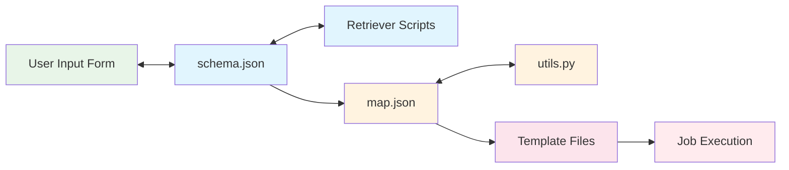

# Environment Development Overview

A **Drona Environment** is a collection of schema, mapping, and driver files that define and implement a scientific workflow within the Drona Workflow Engine. It defines the complete user experience, from the form to job execution, so that each research domain or computational framework can have its own specialized interface.

Each submission of a Drona Environment creates a *workflow instance*, with its own directory and database record. See [Key Concepts](../overview/key-concepts).

## Files in a Drona Environment

These files work together to define the environment:

| File | Required | Purpose |
|---|---|---|
| `schema.json` | Yes | Defines the form: its fields, validation, conditional visibility and dynamic content |
| `map.json` | Yes | Maps form fields to the variables used in scripts, and calls Python functions to compute values |
| `driver.sh` | Yes | Template for the script that submits the jobs |
| `utils.py` | No | Environment-specific Python logic and validation |
| `manifest.yml` | No | Name, description, category, version and required Drona version |
| `icon.png` | No | Icon shown on the start page |

Larger environments usually add subdirectories for the parts of the form and scripts, for example separate Create and Manage pages:

```
MyEnvironment/
├── schema.json
├── map.json
├── driver.sh
├── utils.py
├── manifest.yml
├── icon.png
├── schemas/      # create.schema.json, manage.schema.json
├── drivers/      # driver-create.sh, driver-manage.sh
└── jobscripts/   # job script templates
```

New to this? Start with the [tutorial](../tutorial). Supporting infrastructure includes [retriever scripts](./retriever-scripts) for dynamic content, and a [shared library](./shared-library) of form components, map fragments, retrievers and HTML templates that any environment can reuse.



## Where Drona Environments Come From

- **Environment repository.** A site can point Drona at a repository of shareable environments, which users add with **Import environment**. See [Publishing Environments](./publishing).
- **System environments.** Administrators install these for all users.
- **User environments.** Created or imported into your personal workspace, so you can customize and experiment without affecting anyone else. See [User Environments](./user-environments).
