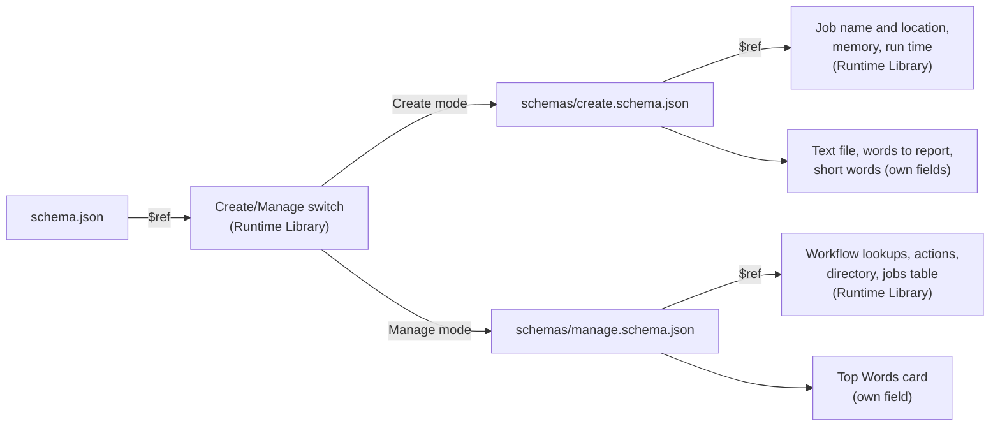

import Snippet from '@site/src/components/Snippet';

# Schema Files

Schema files (`schema.json`) define the user interface for Drona Environments through JSON configurations that generate dynamic forms. These files control what users see, how they interact with the workflow, and what data gets collected for job execution.

Each element in the JSON becomes one part of the form. Here is part of the schema of the [tutorial's](../tutorial/index.md) WordCount environment, next to the form Drona draws from it: **Text file** through **Minimum word length**.

<div className="schema-to-form">
<div>

<Snippet file="schemas/create.schema.json" json={["input_file", "top_n", "filter_short", "min_length"]} />

</div>
<div>


</div>
</div>

## Schema File Organization

Every Drona Environment must contain a file called `schema.json` in its root directory. This file defines the complete user interface for the environment and serves as the entry point for form generation. Schema can be described via multiple files as described in the [Schema Decomposition](#schema-decomposition) section.

## Standard Field Structure

Each field in a schema follows a consistent structure with required and optional properties:

```json
{
  "fieldName": {
    "type": "text",
    "name": "formFieldName", 
    "label": "Display Label",
    "help": "Descriptive help text for users"
  }
}
```

The `type` property determines which form component will be rendered, while `name` specifies the field identifier used in form submission. The `label` provides user-facing text, and `help` offers additional guidance through tooltips or inline descriptions. Elements often have optional properties that differ from component to component and can be found in the [Form Components](../frontend/form-components).

## Component Types

Schema files can utilize all available [Frontend Form Components](../frontend/form-components), including text inputs, selectors, file pickers, and specialized components like module selectors and time inputs. Each component type has specific properties and behaviors documented in the frontend components section.

Components can be organized using containers such as `rowContainer` and `collapsibleRowContainer` that group elements together for conditional display or stylistic purposes to control layout. Containers enable better organization of related fields and create intuitive user interfaces that guide users through the configuration.

## Workflow Button Labels

The two workflow buttons default to **Generate** (on the form) and **Run** (in the generated-scripts window, titled **Generated Scripts**). A schema can change all three with a [`buttonLabels`](../frontend/form-components#buttonlabels) element. It only applies while it is visible, so an environment with Create and Manage modes can put one inside its Manage schema and label that mode for actions:

```json
{
  "drona_buttons": {
    "type": "buttonLabels",
    "preview": "Generate action",
    "submit": "Run action",
    "title": "Action Preview"
  }
}
```

Put it at the top level of `schema.json` to change the labels for the whole environment. When several are visible, the most deeply nested one wins.

## Acting on an Existing Workflow

Add `"workflowTarget": true` to an element whose value is a workflow id (a `dynamicSelect` or `dynamicTable` filled by `builtin:db_options`). While that element is visible and has a selection, the form also sends the selection as the reserved field `drona_target_wf`, and the run acts on that workflow instead of creating a new one: no new record or directory, and the driver runs in the workflow's directory with its `DRONA_WF_*` variables. The shared Manage picker in `runtime_support/forms/drona_create_manage*.json` already sets it. See [Driver Scripts](./driver#runs-on-an-existing-workflow-manage-actions).

## Dynamic Content Integration

Schema files integrate dynamic content through retriever scripts that populate field options or display real-time information. The script provided will be executed when the field loads and whenever user input triggers an update. For detailed information about creating and configuring retriever scripts, see [Retriever Scripts](./retriever-scripts).

```json
{
  "dynamicField": {
    "type": "autocompleteSelect",
    "retriever": "scripts/retrievers/search_data.py",
    "placeholder": "Search for options..."
  }
}
```

## Conditional Logic

Schema files support conditional field display based on user selections, allowing environments to show relevant options while hiding unnecessary complexity. Conditional logic is evaluated when the form loads and whenever referenced field values change. For more detailed information about conditional expressions and advanced patterns, see [Conditional Logic](./conditionals).

```json
{
  "operationType": {
    "type": "select",
    "name": "operation",
    "options": [
      {"value": "basic", "label": "Basic Mode"},
      {"value": "advanced", "label": "Advanced Mode"}
    ]
  },
  "advancedOptions": {
    "type": "text",
    "name": "advancedConfig",
    "label": "Advanced Configuration",
    "condition": "operation.advanced"
  }
}
```

This creates adaptive interfaces that respond to user choices and provide contextual configuration options through form branching.

## Schema Decomposition

For complex environments, a schema can be split over several files with JSON references (`$ref`). This keeps each file small, and lets environments share parts instead of copying them.

The WordCount environment from the tutorial shows how the pieces fit together. Its `schema.json` is only a `$ref` to the Runtime Library's Create/Manage switch, which loads a schema file of the environment for each mode. Those files mix the environment's own fields with more shared parts:



A reference replaces the element that contains it. It can point to a whole file, or to one element in a file with a path after `#`:

```json
{
  "mode": {
    "type": "select",
    "name": "operationType",
    "label": "Operation",
    "options": [
      { "value": "inference", "label": "Inference" },
      { "value": "training", "label": "Training" }
    ]
  },
  "inferenceSection": {
    "$ref": "schema_components/inference.json",
    "condition": "operationType.inference"
  },
  "trainingSection": {
    "$ref": "schema_components/training.json#/modelContainer",
    "condition": "operationType.training"
  }
}
```

Paths are relative to the environment's directory, or absolute. Keys written next to `$ref`, such as the `condition`s above, are added to the referenced element and override its own values.

### Referencing a shared/curated component directory

To reference components from a fixed directory shared across environments (rather than duplicating them per environment), use the `$DRONA_RUNTIME_DIR` placeholder inside the `$ref` path. It is expanded to the server's `runtime_support` directory before the schema is parsed, so the reference resolves to an absolute path:

```json
{
  "inferenceContainer": {
    "elements": {
      "sharedSection": {
        "$ref": "$DRONA_RUNTIME_DIR/inference.json#/modelContainer"
      }
    },
    "condition": "operationType.inference"
  }
}
```

`$DRONA_RUNTIME_DIR` is set automatically — no additional configuration is required. This works alongside the relative and absolute path conventions above — plain relative paths (e.g. `schema_components/training.json`) still resolve against the environment directory.

In practice, shared fragments live under `runtime_support/forms/`, alongside a matching set of shared retriever scripts and HTML templates. See [Drona Runtime Library](../runtime-library/index.md) for the full layout and conventions.
