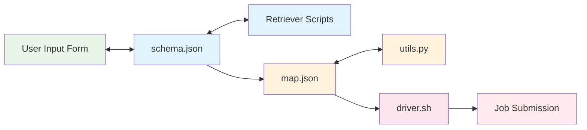

# Introduction

**Drona Workflow Engine** is a framework for running scientific workflows on HPC clusters through a web interface. Researchers fill out a form made for their workflow, and Drona generates the scripts, validates the configuration, submits the jobs and helps monitor them. It runs as an [Open OnDemand](../integrations/open-ondemand) app and can be deployed at any site. Slurm is the supported scheduler today.

Drona was developed by High Performance Research Computing at Texas A&M University.

Terms such as *Drona Environment* have a specific meaning in these docs; see [Key Concepts](./key-concepts).

## The Problem

HPC resources are becoming increasingly complex while simultaneously growing more popular among researchers who may lack traditional HPC skills. Writing Slurm scripts, managing modules, configuring multi-stage pipelines — these tasks create a steep learning curve that leads to frustration, inefficient resource usage, and increased burden on HPC support teams.

## How Drona Solves It

Drona abstracts HPC complexity behind workflow-specific forms while keeping the researcher in full control.

### Guided Configuration

Researchers choose a Drona Environment and fill out a form tailored to that scientific workflow. The form adapts based on user selections — fields appear, hide, and validate in real time. No Slurm syntax or HPC knowledge is required.

### Full Transparency

Before submission, Drona displays all generated scripts in a fully editable preview window. Researchers can review exactly what will run, make adjustments, and catch issues before they reach the scheduler. A message pane provides validation warnings and environment-specific guidance.

### Monitoring and Management

After submission, a Drona Environment can offer a Manage view for each workflow instance, with job status, logs, resource usage and charts, plus actions such as rerun and cancel. See [Monitoring](../using-drona/monitoring).

### Extensible Framework

Drona is not just an assistant — it's a framework. A Drona Environment is defined declaratively through a small set of files:

- **`schema.json`** — Defines the form interface and field behavior
- **`map.json`** — Maps form values to job script variables
- **`driver.sh`** — Template for the generated submission script
- **`utils.py`** — Optional custom processing logic

Anyone can create, customize, and share Drona Environments. System administrators deploy them for all users, while researchers can develop and test their own in a personal workspace.

### Dynamic Content

Drona Environments can include retriever scripts that fetch live data — available GPU types, module versions, running job statuses — and populate form fields dynamically. Forms can therefore respond to the current state of the cluster.

### Validation and Feedback

Drona analyzes input values and provides warnings before submission. For example, it might flag that a GPU was requested for longer than the cluster's maximum GPU wall time, or that a required module is not available on the selected cluster.

## Who Is Drona For?

- **Researchers** who want to run scientific workflows on HPC without learning Slurm
- **HPC administrators** who want to provide guided, validated job submission for their users
- **Environment developers** who want to build shareable, reusable Drona Environments

## Choose Your Path

- **I want to run jobs:** [Using Drona](../user-guide/using-drona)
- **I want to build an environment:** [Build Your First Environment](../tutorial)
- **I run a cluster:** [Setup](../setup)
