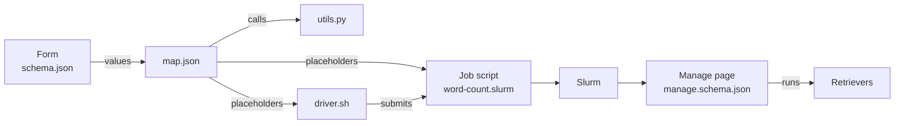

# Build Your First Environment

This tutorial walks through **WordCount**, a complete Drona Environment that reports the most common words in a text file. The science is deliberately simple so that you can focus on how an environment works: a form, a job that uses its values, and a page that shows the results.

WordCount uses the same building blocks as real environments, including Drona's shared form parts and Slurm settings, so what you see here is what you'll use in your own.

## The Pages

Each page follows one stage of the environment, from what the user sees to the code behind it:

| Page | What the user sees | Files explained |
|---|---|---|
| [1. The Form](./part-1.md) | The form | `schema.json`, `schemas/create.schema.json` |
| [2. From Form to Job Script](./part-2.md) | The generated job script and messages | `map.json`, `utils.py`, `jobscripts/word-count.slurm` |
| [3. Submit the Workflow](./part-3.md) | The output of **Run** | `driver.sh`, `drivers/` |
| [4. The Manage Page](./part-4.md) | The workflow's jobs and results | `schemas/manage.schema.json`, `retrievers/show_results.sh` |
| [5. Share It](./part-5.md) | WordCount on the environments page | `manifest.yml` |

## Written Once, Reused Everywhere

WordCount writes only what is specific to counting words. Everything else comes ready-made from the [Drona Runtime Library](../runtime-library/index.md), which every environment can use:

| WordCount writes | WordCount reuses from the library |
|---|---|
| The four questions: text file, number of words, short-word filter and its length | The Create/Manage switch and the table of earlier runs |
| Checks for its own input, with messages | The job name and location field |
| The job script that counts the words | Memory and run time fields, with checks against the cluster's limits and the matching Slurm settings |
| The **Top Words** card and the script that fills it | The submit command that records the run's jobs |
| | The whole Manage page apart from **Top Words**: workflow actions, workflow directory and Slurm jobs |

On the following pages, code that uses the library is marked with a **Uses the Drona Runtime Library** badge.

## The Files

```
WordCount/
├── schema.json                  ● The form: switches between the Create and Manage pages
├── map.json                     ● Turns form values into placeholders for the scripts
├── driver.sh                    ● The script Run executes
├── manifest.yml                 ○ Name, description and version shown on the environments page
├── utils.py                     ○ Python functions the map calls: checks, messages, choices
├── schemas/
│   ├── create.schema.json       ◆ The Create page: the questions the user answers
│   └── manage.schema.json       ◆ The Manage page: jobs, results and actions for a run
├── jobscripts/
│   └── word-count.slurm           The job that counts the words
├── drivers/
│   ├── driver-create.sh           Submits the job
│   └── driver-manage.sh           Carries out the chosen workflow actions
└── retrievers/
    └── show_results.sh            Shows the results on the Manage page
```

Only some of these names are fixed:

- **● Required.** Every environment has `schema.json`, `map.json` and `driver.sh` at its top level, with exactly these names.
- **○ Optional, fixed name.** Drona looks for `manifest.yml` and `utils.py` (and an `icon.png`) at the top level when they exist.
- **◆ Fixed because of a shared part.** WordCount uses the shared Create/Manage switch from the Drona Runtime Library, which loads `schemas/create.schema.json` and `schemas/manage.schema.json` from the environment. Any environment that uses the switch needs these two files at exactly these paths. Without the switch, you don't need them.
- **No mark: your choice.** `jobscripts/`, `drivers/` and `retrievers/` are just a tidy way to organise WordCount. Nothing in Drona expects them: the files are found because WordCount's own code names them. `utils.py` loads `drivers/driver-create.sh` and the job script, and `manage.schema.json` names `retrievers/show_results.sh`. Use whatever layout suits your environment; a small one can keep everything at the top level.

This is how they work together:



## Before You Start

You need access to Drona on a Slurm cluster, and a plain text file to analyze.

Find your Drona directory: it is the `drona_dir` value in `~/.drona/config.json`. Copy the example from the Drona repository into your personal environments:

```bash
cp -r website/examples/word-count <drona_dir>/environments/WordCount
```

The complete example is in the repository under [`website/examples/word-count`](https://github.com/tamu-edu/dor-hprc-drona-composer/tree/master/website/examples/word-count). All code on these pages is taken straight from those files, so it always matches what you copied.

Reload Drona and **WordCount** appears on the environments page with a **User** tag. You're ready for [Part 1](./part-1.md).
