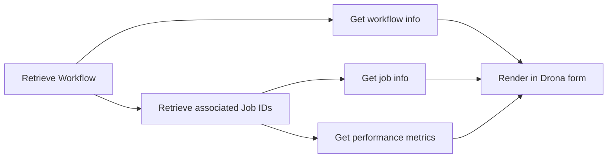

# Monitor Workflows

Submitting a workflow is only the beginning. Researchers want to know whether it is running, whether it is working as intended, and what it produced. On an HPC cluster that usually means logging in to a terminal, checking the queue, reading log files and copying results to a desktop to look at them. Drona's monitoring brings that into the same interface you used to create the workflow, so you can follow your work and act on it without switching tools.

## Manage Mode

Environments that support monitoring offer a **Manage** mode next to **Create**. In Manage mode you pick one of your workflows and the environment shows what it is doing and what it has produced. You can also open a workflow directly from **Recent Workflows** on the environments page.

What you see depends on the workflow. The environment's author decides what is useful to show, so it can include:

- **Domain-specific results**: the scores, plots, structures or other artifacts the scientific application produces, presented so you can judge the outcome without downloading files or opening a separate program.
- **Job-specific information**: the state of each job in the workflow, how long it has run, its output and where its files are.
- **General information**: details that aren't specific to the workflow at all, such as resource utilization graphs that show how well the jobs use the CPUs, memory and GPUs they asked for. These help you request the right resources next time.

Manage mode can also offer actions on a workflow, for example to cancel it or to run it again.

## How Monitoring Works Internally

Drona's monitoring relies on its **workflow history database**, which stores metadata that Slurm alone cannot provide such as the Drona environment used, the working directory, and all Slurm job IDs associated with the workflow. This database is populated automatically during job submission via the `drona_wf_driver_sbatch` driver template, which submits batch jobs, captures their IDs, and writes them back to the database record.

When you open Manage mode and select a workflow, Drona follows this pipeline:

For more details on the database schema, querying, or how `drona_wf_driver_sbatch` records job IDs, see the [Workflow History Database](../environments/database) page. For the complete list of the retriever functions that power the job monitoring, refer to [Retriever Scripts](../environments/retriever-scripts) page.

